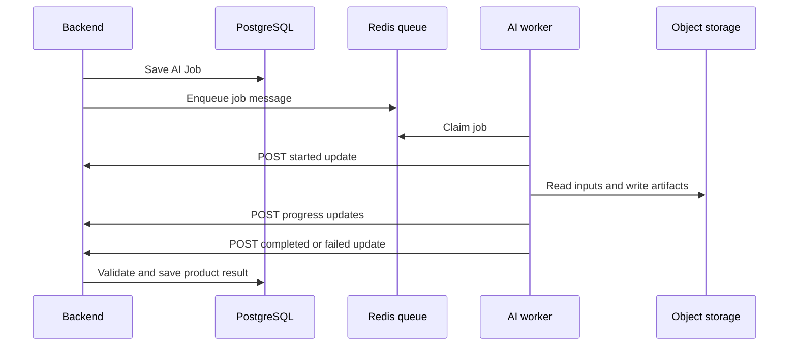

# Backend/AI contract

## Why this contract is small

The backend creates AI Jobs and puts them on a Redis queue. The AI worker processes a job and reports status through one internal backend endpoint. The two repos share versioned JSON schemas, but they do not need a bidirectional event platform.



## Queue message

Redis carries one message shape:

```json
{
  "schema_version": 1,
  "job_id": "01J...",
  "job_type": "analyze_session",
  "practice_session_id": "01J...",
  "analysis_attempt": 1,
  "created_at": "2026-09-02T12:30:00Z",
  "trace_id": "01J...",
  "payload": {}
}
```

`job_type` is one of:

- `analyze_session`
- `analyze_answer`
- `generate_report`
- `erase_ai_data`

The worker validates the schema before starting. Repeated delivery with the same `job_id` resumes or returns the existing outcome rather than repeating completed work.

## Job payloads

### `analyze_session`

```json
{
  "presentation": {
    "artifact_id": "01J...",
    "object_key": "uploads/team/project/video",
    "checksum": "sha256:...",
    "media_type": "video/mp4"
  },
  "supporting_documents": [],
  "rubric": {"rubric_id": "startup_pitch", "version": 1},
  "requested_capabilities": ["speech", "diarization", "vision", "audio", "documents", "questions"]
}
```

### `analyze_answer`

```json
{
  "qa_round_id": "01J...",
  "question_id": "01J...",
  "answer_id": "01J...",
  "answered_by": "01J...",
  "audio": {
    "artifact_id": "01J...",
    "object_key": "answers/team/session/audio",
    "checksum": "sha256:...",
    "media_type": "audio/webm",
    "duration_ms": 84000
  },
  "remaining_follow_ups": 2
}
```

### `generate_report`

```json
{
  "report_id": "01J...",
  "analysis_artifact": {
    "artifact_id": "01J...",
    "object_key": "ai/session/analysis.json",
    "checksum": "sha256:..."
  },
  "qa_artifact": {
    "artifact_id": "01J...",
    "object_key": "ai/session/qa.json",
    "checksum": "sha256:..."
  },
  "speaker_mappings": [
    {"speaker_label": "SPEAKER_00", "user_id": "01J...", "display_name": "Member name"}
  ]
}
```

The report result must include team feedback and one feedback section for every supplied mapping.

### `erase_ai_data`

Erasure jobs have no Analysis Attempt. Their queue envelope may omit `practice_session_id` and `analysis_attempt`; those fields remain required for analysis and report jobs. No sentinel resource IDs are used.

The payload also carries server-derived `practice_session_ids`, `answer_ids`, `asset_version_ids`, and `retention_only` (default false). Project erasure enumerates every affected session and answer, including an empty list for a Project with no sessions. Explicit session/project deletion removes all AI-owned artifacts, reports, evaluation files, vectors, checkpoints, and scratch media. Retention erasure removes source-linked raw-media derivatives while preserving report/evaluation and answer transcript artifacts. Explicit asset erasure uses `scope: "asset"`, `retention_only: false`, and the complete `asset_version_ids` inventory. The worker deletes AI document records and embeddings for those exact source versions even when `practice_session_ids` is empty; unrelated source versions remain. Any draft sessions included by the Backend are also purged. The worker must never delete backend upload objects.

An erasure completion is validated against its durable Erasure Request and trace ID, independently of deleted product ancestry. Duplicate sequence updates have no repeated side effects.

```json
{
  "erasure_request_id": "01J...",
  "scope": "practice_session",
  "scope_id": "01J..."
}
```

## Worker update endpoint

`POST /internal/v1/ai-jobs/{job_id}/updates`

Authentication: a backend-issued worker credential. It is separate from user JWTs.

Every update uses:

```json
{
  "schema_version": 1,
  "sequence": 3,
  "status": "progress",
  "occurred_at": "2026-09-02T12:30:20Z",
  "trace_id": "01J...",
  "payload": {}
}
```

`status` is `started`, `progress`, `completed`, `failed`, or `cancelled`. Sequence numbers increase within one job. Duplicate or older sequences return `200` with the current job state and do not repeat side effects.

### Started payload

```json
{
  "pipeline_version": "0.1.0"
}
```

### Progress payload

```json
{
  "stage": "speech",
  "progress": 0.45,
  "message": "Transcribing presentation"
}
```

Progress is safe display metadata. It contains no transcript, document text, object key, prompt, or provider error.

### Completed `analyze_session` payload

```json
{
  "analysis_artifact": {
    "artifact_id": "01J...",
    "object_key": "ai/session/analysis.json",
    "checksum": "sha256:...",
    "schema_version": 1
  },
  "primary_questions": [
    {
      "candidate_id": "q-1",
      "text": "What evidence supports the claimed conversion rate?",
      "reason": "The pitch states a rate without a source.",
      "rubric_dimension": "pitch_content_and_evidence",
      "evidence_ids": ["ev_01J..."]
    },
    {
      "candidate_id": "q-2",
      "text": "Which technical assumption is most likely to delay the first release?",
      "reason": "The delivery plan names dependencies but does not rank their risk.",
      "rubric_dimension": "technical_feasibility",
      "evidence_ids": ["ev_01K..."]
    },
    {
      "candidate_id": "q-3",
      "text": "How was the target customer segment validated?",
      "reason": "The pitch defines a segment without presenting validation evidence.",
      "rubric_dimension": "business_reasoning",
      "evidence_ids": ["ev_01M..."]
    }
  ],
  "speaker_labels": ["SPEAKER_00", "SPEAKER_01"],
  "limitations": []
}
```

Exactly three primary questions are required.

### Completed `analyze_answer` payload

```json
{
  "answer_id": "01J...",
  "transcript_artifact_id": "01J...",
  "assessment_artifact_id": "01J...",
  "follow_up": {
    "text": "How would that assumption change if acquisition cost doubled?",
    "reason": "The answer depends on an unstated acquisition-cost assumption.",
    "rubric_dimension": "business_reasoning",
    "evidence_ids": ["ev_01J..."]
  }
}
```

`follow_up` may be absent when the question limit is reached or there is no grounded reason to ask one. When present, its text is at most 1,000 characters and `evidence_ids` contains at least one grounding Evidence reference.

Every accepted current-attempt answer completion saves that Answer's transcript and assessment references, even when a newer answer or skip exists. Recency limits follow-up scheduling only; it must not discard valid assessment data. Duplicate, cancelled, and superseded callbacks retain their existing safeguards.

Finishing Q&A records the user's final answer or skip without waiting for object storage. Report generation waits durably for all required submitted-answer analyses and artifacts. A later completion or retry of a transient storage operation resumes report preparation without repeating the user's command or producing duplicate reports. The existing periodic dispatcher retries report preparation even when no later callback arrives. At most one `generate_report` job is scheduled for each Analysis Attempt; the backend enforces this in persistence.

Backend migration `6f7a8b9c0d1e` adds the report-job uniqueness invariant. It refuses an upgrade over legacy duplicate report jobs rather than deleting history. Inspect and reconcile any duplicate `generate_report` jobs for the same `attempt_id` before applying the migration.

Presenter mapping reads only speaker labels from the current attempt's completed, backend-accepted session-analysis result. Missing, cancelled, failed, or superseded analysis cannot provide labels. Accepted mappings continue to supply individual presenter attribution to report generation.

### Completed `generate_report` payload

```json
{
  "evaluation_artifact": {
    "artifact_id": "01J...",
    "object_key": "ai/session/evaluation.json",
    "checksum": "sha256:...",
    "schema_version": 1
  },
  "report_artifact": {
    "artifact_id": "01J...",
    "object_key": "ai/session/report.json",
    "checksum": "sha256:...",
    "schema_version": 1
  },
  "member_feedback_user_ids": ["01J...", "01K..."],
  "limitations": []
}
```

### Completed `erase_ai_data` payload

```json
{
  "erasure_request_id": "01J...",
  "deleted_records": 14,
  "deleted_objects": 6
}
```

### Failed payload

```json
{
  "stage": "speech",
  "code": "provider_timeout",
  "retryable": true,
  "attempts": 3,
  "message": "Speech analysis did not finish before the stage deadline."
}
```

For a current `analyze_session`, `analyze_answer`, or `generate_report` job, a failed update atomically marks the AI Job, Analysis Attempt, and Practice Session `failed`. Failure metadata stays on the job and attempt. After commit, the backend publishes `practice_session.updated.v1` with the committed session version and current attempt number. Duplicate, cancelled, and superseded callbacks do not change current product state or publish a new failure notification. Other jobs from a failed attempt cannot apply results or progress.

Recovery uses `POST /practice-sessions/{session_id}/retries` with a new idempotency key. It starts a new Analysis Attempt from the immutable Session Manifest, including after an answer or report failure. It does not resume the failed job. The user repeats Q&A and speaker mapping for the new attempt. Earlier attempts, Q&A Rounds, Questions, Answers, and jobs remain recorded; only the latest attempt's Q&A Round is exposed and accepts changes. The worker's `retryable` field describes its failure; it does not block an explicit new user attempt.

Deploy the Backend Q&A-per-attempt migration before this recovery behavior. It removes the one-round-per-session restriction while retaining one round per attempt, and repairs active sessions whose latest attempt is already failed. Repaired states are retained on downgrade. Roll back application code only before sessions have multiple rounds; after that, prefer a forward fix. The migration refuses downgrade when multiple rounds exist rather than deleting history.

Provider bodies and stack traces stay in restricted AI logs.

## Job status endpoint

`GET /internal/v1/ai-jobs/{job_id}` returns the current job status and a `cancel_requested` flag. The worker checks it between expensive stages. It does not expose team or user data beyond what the worker already received in that job.

```json
{
  "id": "123e4567-e89b-12d3-a456-426614174000",
  "job_id": "123e4567-e89b-12d3-a456-426614174000",
  "status": "pending",
  "last_update_sequence": 0,
  "cancel_requested": false
}
```

## Backend validation

The backend does not trust a completed update just because it came from the worker. It verifies:

- job ID, type, attempt, status, and sequence;
- expected Team, Project, and Practice Session ownership;
- artifact prefix and checksum;
- score ranges and rubric version;
- evidence-reference bounds;
- three primary and at most two follow-up questions;
- team feedback and every mapped member's feedback section;
- cancellation and stale-attempt status.

## Versioning

The queue message and update body each have `schema_version`. Additive optional fields remain compatible within version 1. Removing, renaming, retyping, or changing the meaning of a required field creates version 2. Both repos run the same JSON examples as contract tests.
